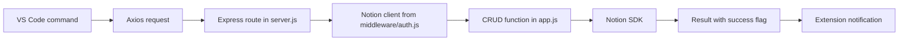
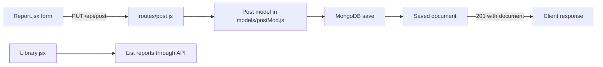
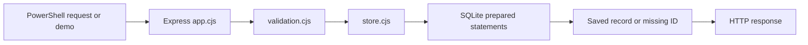

# Request flows

## Original Todo project

The extension must wait for the request and check the result's success flag before notifying. During a read, optional fields must not make an otherwise readable list fail.

## Original FinForge web app

The previous route reached the successful save, then failed while constructing its response. Your fork fixes that response. The companion backend's `routes/report.js` has the analogous flow. Read `lib/utils.js` and `models/train.py` later for its URL-feature and ML work; these are optional for the CRUD lesson.

## Local practice lab

The route controls HTTP behavior; validation controls accepted fields; the store controls persistence. The HTTP tests use temporary local servers. Persistence tests close and reopen a disposable database. None of those checks access the original live integrations.
